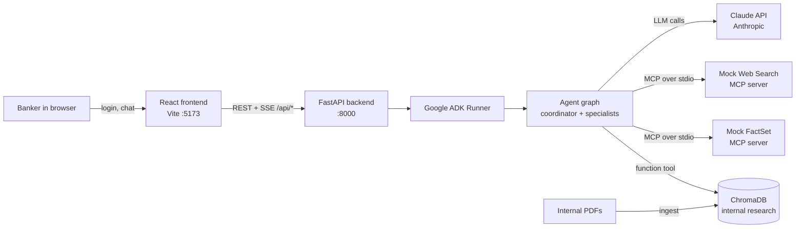
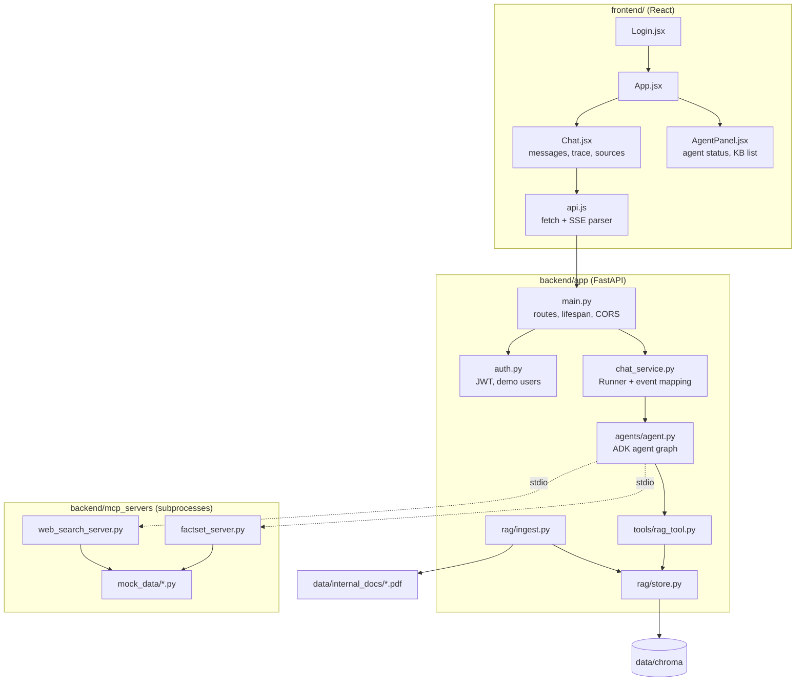
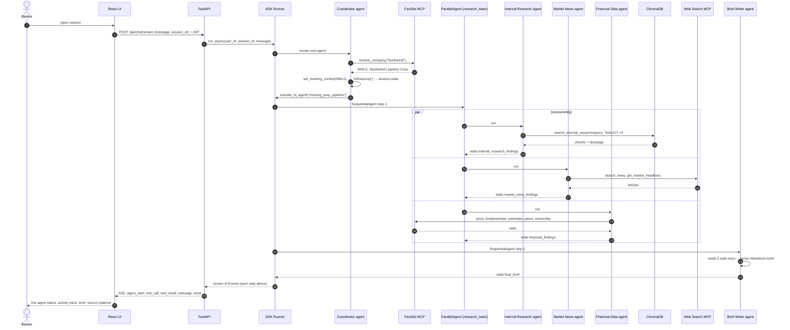
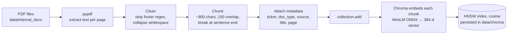
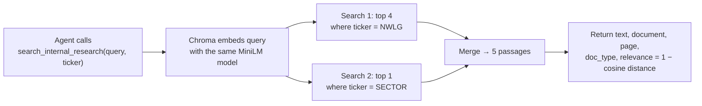
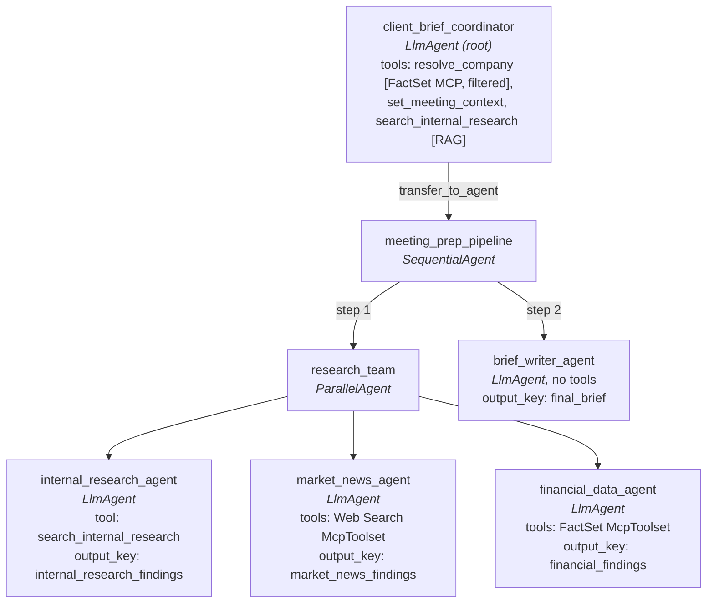
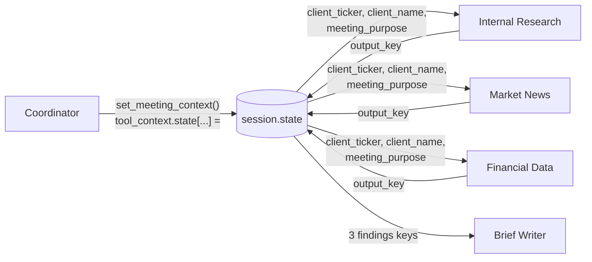

# Client Brief — Technical Architecture & Design

| | |
|---|---|
| **Purpose** | Sample agentic application: an investment banker asks for a client meeting brief and a team of AI agents researches the client from internal documents (RAG), web news (MCP) and market data (MCP). |
| **Stack** | React 18 + Vite · FastAPI · Google ADK 2.14 · MCP Python SDK 2.3 · ChromaDB 1.5 · Claude (Anthropic API, via ADK's `AnthropicLlm`) |
| **Status** | Demo / reference implementation. All companies, people and figures are fictitious. |

## Contents
1. [System overview](#1-system-overview)
2. [Component architecture](#2-component-architecture)
3. [End-to-end request flow](#3-end-to-end-request-flow)
4. [RAG: how it was built and how data is inserted](#4-rag-how-it-was-built-and-how-data-is-inserted)
5. [Google ADK orchestration concepts](#5-google-adk-orchestration-concepts-general)
6. [How this app uses ADK: multi-agent + RAG + MCP](#6-how-this-app-uses-adk-multi-agent--rag--mcp)
7. [Mock MCP servers](#7-mock-mcp-servers)
8. [Backend API and streaming](#8-backend-api-and-streaming)
9. [Frontend](#9-frontend)
10. [Design decisions and trade-offs](#10-design-decisions-and-trade-offs)
11. [Path to production](#11-path-to-production)

---

## 1. System overview



Three kinds of "knowledge" are combined, each reached through a different integration pattern:

| Knowledge | Integration pattern | Why this pattern |
|---|---|---|
| Internal research (PDFs) | **RAG**: vector search, exposed as an ADK *function tool* | Unstructured text; needs semantic retrieval |
| Latest news | **MCP server** (Web Search) | In real life this is an external service; MCP is the standard way to plug external tools into agents |
| Market and financial data | **MCP server** (FactSet) | Structured data from a vendor; vendors increasingly ship MCP servers |

---

## 2. Component architecture



| File | Responsibility |
|---|---|
| `backend/app/main.py` | FastAPI app. On startup, builds the RAG index if empty and creates the `ChatService`. Routes for auth, chat stream and RAG documents. |
| `backend/app/auth.py` | PBKDF2-hashed demo users, JWT (HS256) issue and verify. |
| `backend/app/chat_service.py` | Owns the ADK `Runner` and `InMemorySessionService`; turns ADK `Event`s into small JSON events for the UI. |
| `backend/app/agents/agent.py` | The whole agent graph: five `LlmAgent`s, one `ParallelAgent`, one `SequentialAgent`, MCP toolsets, the state-setting tool. |
| `backend/app/tools/rag_tool.py` | `search_internal_research()`: the RAG tool agents call. |
| `backend/app/rag/store.py` | ChromaDB client, collection, and `search()`. |
| `backend/app/rag/ingest.py` | PDF → text → chunks → ChromaDB. |
| `backend/mcp_servers/*.py` | Mock MCP servers, launched by ADK as child processes. |
| `backend/scripts/generate_sample_pdfs.py` | Generates the 7 sample internal PDFs with ReportLab. |

---

## 3. End-to-end request flow

Example prompt: *"Prepare me for my meeting with Northwind Logistics about refinancing their 2027 notes."*



**Follow-up turn** (e.g. *"What should I avoid with the CEO?"*): the Runner routes the new message back to the coordinator (§6.4). It answers from the conversation history, which already holds the brief, and can call the RAG tool directly for quick lookups.

**Cost per brief:** roughly 15–20 LLM calls: coordinator ~4, internal research ~4, news ~3, financial ~3–6, writer 1. Each tool round trip is an extra LLM call.

---

## 4. RAG: how it was built and how data is inserted

### 4.1 Why ChromaDB

- **Free and open source** (Apache-2.0); `pip install chromadb` is the whole installation.
- **Embedded:** runs inside the FastAPI process and persists to a folder (`backend/data/chroma/`). No database server.
- **Built-in local embeddings:** the default embedding function is **all-MiniLM-L6-v2** (sentence-transformers) run through **ONNX Runtime** on CPU. It produces **384-dimension** vectors and needs **no API key**. The model (~80 MB) downloads once to `~/.cache/chroma/`.
- **Metadata filtering** (`where={"ticker": {"$in": [...]}}`) lets us restrict search to one client's documents.

### 4.2 The source documents

`scripts/generate_sample_pdfs.py` uses **ReportLab (Platypus)** to build realistic internal documents with headings, paragraphs and tables, plus a "confidential / sample" footer on every page:

| File | Type | Content used by the agents |
|---|---|---|
| `HLXB_Equity_Research_Note.pdf` | Equity research | Rating, PT, thesis, estimates table, risks |
| `HLXB_Coverage_Relationship_Memo.pdf` | Coverage memo | Past deals, wallet share, contacts, call reports, opportunities, sensitivities |
| `NWLG_Equity_Research_Note.pdf` | Equity research | Q3 review, refinancing, activist, M&A |
| `NWLG_Coverage_Relationship_Memo.pdf` | Coverage memo | FrostLine M&A, refi, activism defence |
| `AURP_Equity_Research_Note.pdf` | Equity research | PPAs, funding needs, green hybrid |
| `AURP_Coverage_Relationship_Memo.pdf` | Coverage memo | Hybrid vs. stake sale, hyperscaler JV |
| `Sector_Outlook_2027_Capital_Markets.pdf` | Sector outlook | Cross-client market context |

**Naming convention matters:** the ingestion step derives each document's `ticker` from the file-name prefix (`NWLG_...`). Anything without a known ticker prefix is tagged `SECTOR`.

### 4.3 Ingestion pipeline (`app/rag/ingest.py`)



Step by step:

1. **Reset:** `ingest()` deletes every existing ID in the collection, so a re-run is a full, idempotent rebuild.
2. **Extract:** `PdfReader(pdf).pages[i].extract_text()`, **page by page**, so each chunk knows its page number for citations. The PDF's `title` metadata is captured too.
3. **Clean:** a regex removes the repeated confidentiality footer and `Page N`. Without this, every chunk contained the same boilerplate, which skewed similarity scores. Whitespace is then collapsed.
4. **Chunk** (`_chunks`): a sliding window of `CHUNK_SIZE = 900` characters.
   - If a window would cut mid-text, it is shortened to the last `". "` found in its second half, so chunks end on a sentence.
   - The next chunk starts `CHUNK_OVERLAP = 150` characters back, moved forward to a word boundary. The overlap keeps facts that straddle a boundary retrievable.
   - Fragments shorter than 40 characters are dropped.
5. **Metadata** per chunk:
   ```json
   {"ticker": "NWLG", "doc_type": "Coverage / Relationship Memo",
    "source": "NWLG_Coverage_Relationship_Memo.pdf",
    "title": "Client Coverage Memo — Northwind Logistics Corp.", "page": 1}
   ```
6. **Insert:** `collection.add(ids, documents, metadatas)`. IDs are deterministic: `"{file stem}-p{page}-c{chunk#}"`. **We never compute embeddings ourselves.** Chroma calls its embedding function on `documents` during `add`, stores the vectors, and updates its HNSW index.

The collection is created with `metadata={"hnsw:space": "cosine"}` in `store.get_collection()`. Result: **26 chunks from 7 PDFs**.

**When ingestion runs:**
- manually: `python -m app.rag.ingest`
- automatically on API startup if the collection is empty (`lifespan` in `main.py`)
- on demand through `POST /api/rag/reindex`

### 4.4 Retrieval (`app/rag/store.py` and `app/tools/rag_tool.py`)



- `store.search()` calls `collection.query(query_texts=[query], n_results=k, where=...)`. Chroma embeds the query and runs approximate-nearest-neighbour search over the HNSW index.
- **Company-first strategy:** the small MiniLM model tended to rank the broad sector-outlook document above the client's own memo. The tool therefore runs two filtered searches: 4 chunks from the client's documents plus 1 from the sector outlook. This guarantees client-specific context and still adds market colour.
- The tool returns structured hits. The agent is instructed to cite each fact as `[RAG: <file> p.<page>]`, and the UI turns those hits into clickable chips that open the PDF.

### 4.5 How RAG is plugged into the agents

RAG is exposed to ADK as a **plain Python function**. ADK wraps it automatically as a `FunctionTool`:

```python
def search_internal_research(query: str, ticker: str = "") -> dict:
    """Search the bank's INTERNAL research library ... (RAG)."""
```

ADK builds the tool's JSON schema from the **function signature and type hints**, and the tool description from the **docstring**. The LLM sees that schema and decides when to call it and with what `query`. This is "agentic RAG": the model decides how many searches to run and what to search for. The Internal Research agent is told to search at least 3 times (view/estimates, relationship and contacts, opportunities and sensitivities), as opposed to a single fixed retrieve-then-generate step.

---

## 5. Google ADK orchestration concepts (general)

Google's **Agent Development Kit (ADK)** is a code-first Python framework for building agents and multi-agent systems. The core concepts:

### 5.1 Agents

| Type | Class | Behaviour |
|---|---|---|
| **LLM agent** | `LlmAgent` (alias `Agent`) | Uses an LLM to reason, call tools and reply. Has `model`, `instruction`, `tools`, `sub_agents`, `output_key`, etc. *Non-deterministic.* |
| **Sequential workflow** | `SequentialAgent` | Runs its `sub_agents` one after another, in order. *Deterministic, no LLM.* |
| **Parallel workflow** | `ParallelAgent` | Runs its `sub_agents` **concurrently** (asyncio). Each child runs in its own branch of the conversation, but they share session state. *Deterministic.* |
| **Loop workflow** | `LoopAgent` | Repeats sub-agents until a max count or until one escalates. |
| **Custom** | subclass `BaseAgent` | Your own `_run_async_impl` control flow. |

Workflow agents give **predictable orchestration** (what runs, in what order). LLM agents give **flexible reasoning** inside each step. Good designs combine both, as this app does.

### 5.2 Tools

- **Function tools:** any Python function. The schema comes from its signature and docstring. A parameter named `tool_context: ToolContext` is injected by ADK and hidden from the LLM; it gives the tool access to session `state`.
- **MCP tools:** `McpToolset` connects to an MCP server (stdio subprocess, SSE or Streamable HTTP), lists its tools and exposes each one as an ADK tool. `tool_filter` limits which tools an agent sees.
- **Agent-as-tool** (`AgentTool`): wraps an agent so another agent can call it like a function.
- Built-in tools such as Google Search and code execution.

### 5.3 Multi-agent delegation

- **Agent hierarchy:** `sub_agents=[...]` makes a parent/child tree.
- **LLM-driven transfer:** when an `LlmAgent` has sub-agents, ADK adds a `transfer_to_agent(agent_name)` tool. The LLM picks a target based on each sub-agent's `description`, and the Runner hands control over. `disallow_transfer_to_parent` / `disallow_transfer_to_peers` restrict where an agent can transfer.
- **Explicit invocation:** workflow agents call their children directly.

### 5.4 Session, state and events

- **Session:** one conversation (`app_name`, `user_id`, `session_id`). It stores the list of **events** and a key-value **state** dict. Here it's `InMemorySessionService`; `DatabaseSessionService` and `VertexAiSessionService` are the persistent options.
- **State** is the shared memory between agents:
  - `output_key="x"` on an `LlmAgent` saves its final text reply to `state["x"]`.
  - Tools write via `tool_context.state[...]`.
  - Instructions can read state, either with `{key}` templates or, as here, with an **instruction provider** (a function `ctx -> str` that reads `ctx.state`).
- **Events:** everything that happens (user message, model reply, function call, function response, transfer, state change) is an `Event` with an `author` (agent name). State changes travel as `actions.state_delta` and are committed by the session service.
- `include_contents="none"` makes an agent ignore the conversation history and work only from its instruction (and therefore from state). This is useful for focused specialists.

### 5.5 Runner

`Runner(app_name, agent, session_service)` is the execution engine. `runner.run_async(user_id, session_id, new_message)`:
1. appends the user message to the session,
2. picks which agent should handle it (the root agent, or the last active agent if transfer rules allow it),
3. runs the agent loop (model call → tool calls → model call …), following transfers and workflow steps,
4. **yields every `Event` as it happens**, which is what lets us stream progress to the UI,
5. persists events and state deltas.

`runner.close()` cleans up resources such as the MCP subprocesses.

---

## 6. How this app uses ADK: multi-agent + RAG + MCP

### 6.1 Agent graph (`backend/app/agents/agent.py`)



The design is a **hybrid**:
- **LLM-driven routing at the top.** The coordinator understands free-text requests, resolves the client and decides when to start the pipeline.
- **Deterministic workflow underneath.** Once started, the pipeline *always* runs all three researchers in parallel, then the writer. No LLM decides the order, which makes the run predictable, fast and easy to debug.

### 6.2 What each agent does

| Agent | Kind | Inputs | Tools | Output |
|---|---|---|---|---|
| `client_brief_coordinator` | LlmAgent (root) | Banker's message + conversation history | `resolve_company` (FactSet MCP, via `tool_filter`), `set_meeting_context`, `search_internal_research` | Transfers to the pipeline, or answers follow-ups |
| `internal_research_agent` | LlmAgent | `state.client_*` via instruction provider | `search_internal_research` (RAG) | `state.internal_research_findings` |
| `market_news_agent` | LlmAgent | `state.client_*` | `search_news`, `get_market_headlines` (Web MCP) | `state.market_news_findings` |
| `financial_data_agent` | LlmAgent | `state.client_*` | `get_price_snapshot`, `get_fundamentals`, `get_consensus_estimates`, `get_peer_comparison`, `get_ownership` (FactSet MCP) | `state.financial_findings` |
| `brief_writer_agent` | LlmAgent | The three findings keys | none | `state.final_brief` (Markdown shown to the banker) |

### 6.3 How data moves between agents: session state



- **Hand-off contract.** `set_meeting_context(ticker, company_name, meeting_purpose, tool_context)` writes `client_ticker`, `client_name` and `meeting_purpose`. It also **clears** the previous findings keys, so a second brief in the same chat can't reuse stale data.
- **Specialists use `include_contents="none"`.** They don't see the chat transcript, only their instruction, which an *instruction provider* builds from state:
  ```python
  instruction=lambda ctx: f"""You are the Internal Research specialist...
  {_client(ctx)}   # "Client: Northwind Logistics Corp. (ticker NWLG). Meeting purpose: ..."
  ..."""
  ```
  This keeps prompts short and focused and stops the three parallel agents from being distracted by each other's messages.
- **Instruction providers instead of `{key}` templates.** We couldn't confirm that this ADK version supports optional placeholders, and a missing key in a template is an error. A Python function reading `ctx.state.get(...)` with defaults is explicit and safe.
- **Fan-in.** The brief writer's instruction embeds all three findings blocks (or `(no data)`), so it can still write a partial brief if one source failed.

### 6.4 Orchestration mechanics, step by step

1. **Runner → root.** For a new session, the Runner sends the message to `client_brief_coordinator`.
2. **Coordinator reasoning loop.** It calls `resolve_company`, then `set_meeting_context`, then `transfer_to_agent(agent_name="meeting_prep_pipeline")`. ADK added that last tool automatically because the coordinator has `sub_agents=[meeting_prep_pipeline]`, and the target was chosen using the pipeline's `description`.
3. **SequentialAgent** runs `research_team`, then `brief_writer_agent`.
4. **ParallelAgent** starts the three specialists as concurrent asyncio tasks. Their events interleave, which is visible in the UI trace. It finishes when all three finish.
5. **Each specialist** runs its own model → tool → model loop. Its final text is saved to its `output_key`.
6. **Brief writer** makes a single model call over the merged findings.
7. **Next user turn.** The Runner sends the message back to the coordinator. The last author (`brief_writer_agent`) sits under a `SequentialAgent`, which is not an LLM agent and can't take part in transfers, so ADK falls back to the root. This was verified in testing.
8. **Guard rails.** Every specialist has `disallow_transfer_to_parent=True` and `disallow_transfer_to_peers=True`, so none can wander off the plan. Each model call uses Claude with a set reasoning `effort` (default `medium`). Prompts say "Only use facts returned by the tools" and require source tags.

### 6.5 How MCP tools are attached

```python
def _mcp_toolset(script, tool_filter=None):
    return McpToolset(
        connection_params=StdioConnectionParams(
            server_params=StdioServerParameters(command=sys.executable, args=[str(MCP_DIR / script)]),
            timeout=30),
        tool_filter=tool_filter)
```

- On first use, ADK **spawns the server as a child process**, performs the MCP `initialize` handshake over stdin/stdout, calls `list_tools`, and turns each MCP tool (name, description, JSON input schema) into an ADK tool.
- When the LLM calls one, ADK sends an MCP `call_tool` request. The response comes back as MCP content (`{"content":[{"type":"text","text":"<json>"}]}`), which the model reads.
- The coordinator uses the **same FactSet server** with `tool_filter=["resolve_company"]`, so it only sees the lookup tool. Each toolset instance runs its own subprocess.
- To use a real MCP server, replace the connection params, e.g. `StreamableHTTPConnectionParams(url="https://…/mcp", headers=...)`. Agent code and prompts don't change.

### 6.6 The LLM: Claude through ADK

ADK is model-agnostic: an `LlmAgent`'s `model` can be a model string or a `BaseLlm` object. This app passes an
`AnthropicLlm` object:

```python
LEAD_LLM = AnthropicLlm(model=CLAUDE_MODEL, max_tokens=CLAUDE_MAX_TOKENS)              # coordinator, brief writer
SPECIALIST_LLM = AnthropicLlm(model=CLAUDE_SPECIALIST_MODEL, max_tokens=CLAUDE_MAX_TOKENS)  # 3 research agents
GEN_CONFIG = AnthropicGenerateContentConfig(effort=CLAUDE_EFFORT)
```

- `AnthropicLlm` calls the Anthropic Messages API with the official `anthropic` SDK (`AsyncAnthropic()`), which reads
  `ANTHROPIC_API_KEY`. A bare `"claude-..."` string is **not** used, because ADK resolves that to its `Claude` class,
  which goes through Google Vertex AI.
- On each call ADK translates its request into Claude's format: the instruction becomes `system`, ADK tools (Python
  functions and MCP tools) become Claude tool definitions, and Claude's `tool_use` / `tool_result` blocks are mapped back
  to ADK function calls and responses. Agents, tools and prompts are unchanged from any other model.
- `effort` sets how much Claude reasons (`low` … `max`). Setting it also stops ADK sending `temperature`/`top_p`,
  which current Claude models reject. Claude Opus 5.5 always thinks adaptively; its thinking blocks come back empty and
  are passed back unchanged.
- **Prompt caching:** `ChatService` builds the Runner from an `App` with `ContextCacheConfig()`, so ADK marks cache
  breakpoints on every Claude request. The repeated prefix (system prompt, tool definitions, history) is then billed at
  cache-read rates. This matters here because every agent transfer changes the system prompt and tools.
- **Refusal fallbacks are not enabled:** ADK's Claude converter raises on the `fallback` content block that Anthropic's
  server-side fallback feature returns, so turning it on would break a run whenever a fallback happened.

---

## 7. Mock MCP servers

Both servers use the MCP Python SDK 2.x `MCPServer` class (called `FastMCP` in 1.x). Each tool is a decorated function:

```python
mcp = MCPServer(name="factset-mock", instructions="...")

@mcp.tool()
def get_price_snapshot(ticker: str) -> dict:
    """Latest price, daily/YTD performance, 52-week range, market cap..."""

if __name__ == "__main__":
    mcp.run(transport="stdio")
```

| Server | Tools | Data |
|---|---|---|
| `factset_server.py` | `resolve_company`, `get_price_snapshot`, `get_fundamentals`, `get_consensus_estimates`, `get_peer_comparison`, `get_ownership` | `mock_data/factset_data.py`: three fictitious companies, figures consistent with the PDFs |
| `web_search_server.py` | `search_news(query, max_results, days)`, `get_market_headlines` | `mock_data/news_data.py`: articles stored as `days_ago`, turned into real dates at request time so the news always looks current |

- **Name resolution** (`resolve()`): exact ticker/name/alias match, then a fuzzy "contains" match. Unknown companies return an error plus the list of covered companies, which the coordinator relays to the banker.
- Every response includes `source` and `as_of` fields for traceability.
- The servers can be run standalone for debugging (`python mcp_servers/factset_server.py`) or inspected with any MCP client.

---

## 8. Backend API and streaming

| Method & path | Auth | Purpose |
|---|---|---|
| `GET /api/health` | none | status, model, number of RAG chunks |
| `POST /api/auth/login` | none | `{username,password}` → `{access_token, user}` |
| `GET /api/auth/me` | Bearer | current user |
| `POST /api/chat/stream` | Bearer | `{message, session_id}` → **Server-Sent Events** |
| `GET /api/rag/documents` | Bearer | indexed documents with chunk counts |
| `GET /api/rag/documents/{name}` | Bearer or `?token=` | serves the PDF (path-traversal safe) so citations open in a new tab |
| `POST /api/rag/reindex` | Bearer | rebuild the index |

**Auth.** Demo users have PBKDF2-SHA256 password hashes. The JWT (HS256, 8 h) carries username, name and role. The username becomes the ADK `user_id`, so sessions are isolated per banker.

**Event mapping** (`chat_service.py`). Each ADK `Event` is converted into one or more UI events:

| UI event | Derived from | Used for |
|---|---|---|
| `agent_start` | first event authored by an agent in this turn | agent card turns "running" |
| `tool_call` | `event.get_function_calls()` | activity trace (tool + args + source badge) |
| `tool_result` | `event.get_function_responses()`, summarised; RAG results carry `citations`, news results carry `articles` | trace + "Sources used" chips |
| `message` | text parts; `final=true` for coordinator and brief writer | final answer vs. "specialist findings" drawer |
| `agent_done` | a specialist's final text | agent card turns "done" |
| `error` | any exception (e.g. missing API key) | error banner |
| `done` | end of run | UI unlocks |

Tool names map to a source label (`RAG`, `FactSet MCP`, `Web Search MCP`, `Orchestration`). MCP responses are unwrapped from their `content[0].text` JSON before summarising.

SSE is sent as `data: {...}\n\n` frames with `Cache-Control: no-cache` and `X-Accel-Buffering: no`, so proxies don't buffer it.

---

## 9. Frontend

- **`api.js`:** stores the JWT in `localStorage`. `streamChat()` uses `fetch` with a `ReadableStream` reader (not `EventSource`, which can't send POST bodies or auth headers) and splits the stream on blank lines into SSE frames. A 401 response logs the user out.
- **`Chat.jsx`:** each assistant turn keeps `events`, `drafts` (specialist outputs) and `answers` (final). It renders:
  1. a collapsible **Agent activity** trace,
  2. **Specialist agent findings**,
  3. the **brief** as Markdown (`react-markdown` + `remark-gfm` for tables),
  4. **Sources used**: RAG chips (document · page · relevance, linking to the PDF), news articles and the FactSet tools that were called.
- **`AgentPanel.jsx`:** live status (idle / running / done) and tool-call count for each agent; the knowledge-base list comes from `/api/rag/documents`.
- **Session handling:** each chat gets a `crypto.randomUUID()` session ID. "New chat" starts a fresh ADK session.
- Vite proxies `/api` to `localhost:8000` in development, so there are no CORS issues.

---

## 10. Design decisions and trade-offs

| Decision | Alternative | Why |
|---|---|---|
| Hybrid: LLM routing at the top + deterministic Sequential/Parallel pipeline | Fully LLM-driven delegation (coordinator calls each specialist itself) | Predictable, always covers all three sources, faster (parallel), fewer LLM calls, easy to explain in a demo |
| `transfer_to_agent` into the pipeline | Wrapping the pipeline in `AgentTool` | Transfer keeps every inner event in the main Runner stream, so the UI can show each agent live; AgentTool would hide the inner events |
| Session state + `output_key` for hand-offs | Passing the conversation history | Explicit data contract; specialists use `include_contents="none"` and get small, focused prompts |
| RAG as a function tool (agentic RAG) | Fixed retrieve-then-generate | The agent chooses queries and runs several searches covering different angles |
| ChromaDB embedded + local MiniLM | Hosted vector DB / paid embeddings | Zero cost, zero infrastructure, no extra API key |
| Character chunking with sentence boundaries | Token-based / semantic chunking | Simple and adequate for short, well-structured memos |
| Company-first two-stage retrieval | Single search | Small embedding model over-ranked generic sector text |
| Real MCP servers serving mock data | Python functions pretending to be MCP | Demonstrates the actual protocol; swapping to a real vendor server is a config change |
| SSE over `fetch` | WebSockets | One-way streaming is all that's needed; works through standard HTTP tooling |

**Known limitations**
- In-memory sessions are lost on restart.
- Demo auth only.
- MiniLM retrieval quality is modest; there's no reranker.
- The full index is rebuilt on every ingest (fine for 7 docs).
- Each brief costs about 15–20 Claude calls; Anthropic rate limits apply.

---

## 11. Path to production

| Area | Upgrade |
|---|---|
| **LLM** | Tune `CLAUDE_EFFORT` and per-agent models from measured quality; Claude on Vertex AI (ADK's `Claude` class) or Amazon Bedrock for cloud-native data controls |
| **RAG** | Stronger embeddings (e.g. `text-embedding-005`, `bge-large`), a reranker, hybrid BM25 + vector search, incremental ingestion, document-level entitlements (filter by the banker's access rights); or a managed service (Vertex AI RAG Engine, pgvector, Qdrant) — only `rag/store.py` changes |
| **MCP** | Real vendor MCP servers over Streamable HTTP with auth headers (`header_provider`); timeouts, retries |
| **Sessions / memory** | `DatabaseSessionService` (Postgres) and ADK memory services for cross-session recall |
| **Security** | SSO (OIDC/SAML), RBAC, audit log of every tool call (the event stream already has everything needed), PII and MNPI controls, prompt-injection filtering of retrieved text |
| **Quality** | ADK evaluation sets (`adk eval`) with golden briefs; checks that every number in a brief appears in a tool result |
| **Ops** | Containerise backend and frontend; deploy to Cloud Run / Vertex AI Agent Engine; OpenTelemetry tracing (ADK emits spans) |
