# Google ADK Multi-Agent Tutorial for Beginners

**Learn how multi-agent apps work by building up to the Client Brief app in this repo.**

| | |
|---|---|
| **Who it's for** | Developers who know basic Python but are new to AI agents and Google ADK |
| **What you'll learn** | What an agent is, how to give agents tools, how a coordinator hands work to sub-agents, how agents run in sequence or in parallel, and how they share data |
| **Running example** | `backend/app/agents/agent.py` in this repository |
| **ADK version** | `google-adk` 2.14 (Python). The LLM is Claude via ADK's `AnthropicLlm`. |

## Contents
- [Part 0 — The big picture](#part-0--the-big-picture)
- [Part 1 — Core building blocks](#part-1--core-building-blocks)
- [Part 2 — Your first agent](#part-2--your-first-agent)
- [Part 3 — Defining tools](#part-3--defining-tools)
- [Part 4 — Multiple agents: the coordinator and sub-agents](#part-4--multiple-agents-the-coordinator-and-sub-agents)
- [Part 5 — Workflow agents: Sequential, Parallel, Loop](#part-5--workflow-agents-sequential-parallel-loop)
- [Part 6 — Sharing data between agents](#part-6--sharing-data-between-agents)
- [Part 7 — Three ways for a coordinator to use other agents](#part-7--three-ways-for-a-coordinator-to-use-other-agents)
- [Part 8 — Walkthrough: the Client Brief agent graph](#part-8--walkthrough-the-client-brief-agent-graph)
- [Part 9 — Running agents and watching what they do](#part-9--running-agents-and-watching-what-they-do)
- [Part 10 — Common mistakes](#part-10--common-mistakes)
- [Part 11 — Exercises](#part-11--exercises)
- [Glossary](#glossary)

---

## Part 0 — The big picture

### What is an "agent"?

A plain LLM call is **question in, text out**. An **agent** is an LLM that runs in a loop and can take actions:

1. It reads its **instructions** (what its job is) and the conversation.
2. It decides whether it needs more information and, if so, calls a **tool** (a Python function, an API, a database search…).
3. It reads the tool's result and repeats until it can answer.

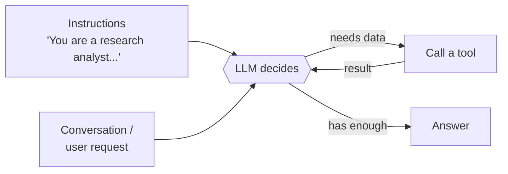

### Why multiple agents?

One agent with 20 tools and a giant prompt gets confused, slow and hard to debug. It's better to split the work the way a real team does, with each agent focused on one job:

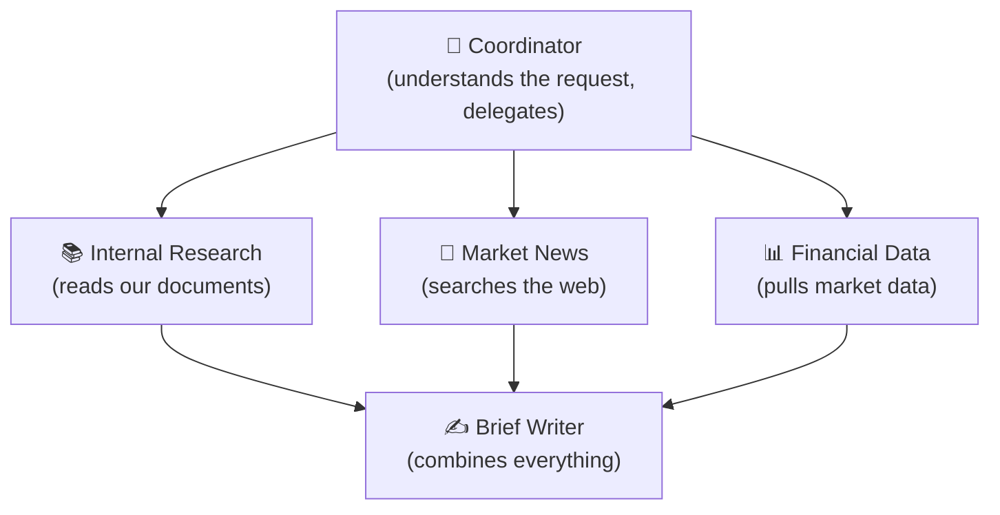

Benefits:
- **Focus:** each agent has a short prompt and only the tools it needs.
- **Speed:** independent agents can run at the same time.
- **Reliability:** each piece can be tested and fixed on its own.
- **Clarity:** you can see exactly which agent did what.

### What is Google ADK?

**ADK (Agent Development Kit)** is Google's open-source Python framework for building agents. It gives you:
- ready-made agent classes (LLM agents and workflow agents),
- automatic conversion of Python functions into tools,
- sessions and shared state,
- a `Runner` that executes everything and reports each step as an event,
- support for many models (Gemini, Claude, others through LiteLLM) and for MCP tool servers.

---

## Part 1 — Core building blocks

Five concepts cover almost everything:

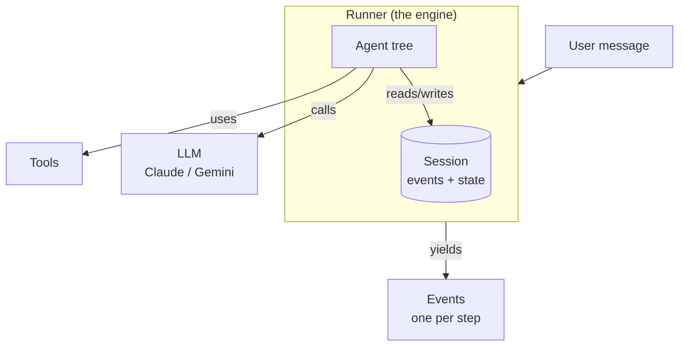

| Concept | Analogy | In code |
|---|---|---|
| **Agent** | A team member with a job description | `LlmAgent`, `SequentialAgent`, `ParallelAgent`, `LoopAgent` |
| **Tool** | Something the team member can use (a phone, a database) | A Python function, an `McpToolset`, an `AgentTool` |
| **Session** | The meeting notes for one conversation | `InMemorySessionService().create_session(...)` |
| **State** | A shared whiteboard everyone in the session can read and write | `session.state["client_ticker"] = "NWLG"` |
| **Runner** | The office manager who runs the meeting and records everything | `Runner(...).run_async(...)` |
| **Event** | One line in the meeting log ("Coordinator called resolve_company") | Yielded by `run_async` |

There are two families of agent:

| Family | Classes | Who decides what happens next? |
|---|---|---|
| **LLM agents** | `LlmAgent` (also called `Agent`) | **The LLM**, at runtime. Flexible but less predictable. |
| **Workflow agents** | `SequentialAgent`, `ParallelAgent`, `LoopAgent` | **Your code.** Fixed order, no LLM involved, fully predictable. |

> 💡 The key idea of ADK multi-agent design: **use workflow agents for the parts that should always happen the same way, and LLM agents where judgment is needed.**

---

## Part 2 — Your first agent

### 2.1 The smallest useful agent

```python
from google.adk.agents import LlmAgent
from google.adk.models.anthropic_llm import AnthropicLlm


def get_stock_price(ticker: str) -> dict:
    """Get the latest stock price for a ticker symbol.

    Args:
        ticker: the stock ticker, e.g. "NWLG".
    """
    prices = {"NWLG": 109.25, "AURP": 55.80}          # pretend data
    if ticker.upper() not in prices:
        return {"status": "error", "message": f"Unknown ticker {ticker}"}
    return {"status": "ok", "ticker": ticker.upper(), "price": prices[ticker.upper()]}


price_agent = LlmAgent(
    name="price_agent",                                  # unique id, no spaces
    model=AnthropicLlm(model="claude-opus-5-5"),         # which LLM to use
    description="Answers questions about stock prices.", # used by OTHER agents to pick this one
    instruction="You answer stock price questions. Use the get_stock_price tool. Be brief.",
    tools=[get_stock_price],                             # a plain function becomes a tool
)
```

What each field does:

| Field | Purpose |
|---|---|
| `name` | Identifier. Shows up in events and is used for transfers. |
| `model` | The LLM. Here it's Claude through the Anthropic API (needs `ANTHROPIC_API_KEY`). With Gemini you'd write `model="gemini-..."`. |
| `description` | A one-line summary **for other agents**. A coordinator reads it to decide whether to delegate here. |
| `instruction` | The system prompt: this agent's job description and rules. |
| `tools` | What this agent can use. |

### 2.2 What happens when it runs

User: *"What's Northwind trading at? Ticker NWLG."*

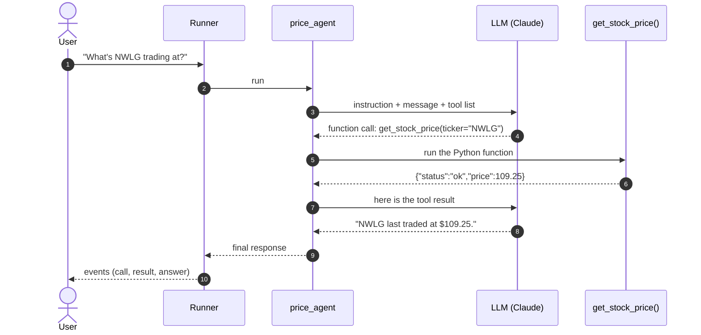

The LLM **never runs your code**. It only *asks* for a tool call (name + arguments). ADK runs the function and sends the result back. The loop continues until the LLM replies with text and no further tool calls.

### 2.3 Running it with a Runner

```python
import asyncio
from google.adk.runners import Runner
from google.adk.sessions import InMemorySessionService
from google.genai import types


async def main():
    session_service = InMemorySessionService()
    runner = Runner(app_name="demo", agent=price_agent, session_service=session_service)
    await session_service.create_session(app_name="demo", user_id="u1", session_id="s1")

    message = types.Content(role="user", parts=[types.Part(text="What's NWLG trading at?")])
    async for event in runner.run_async(user_id="u1", session_id="s1", new_message=message):
        for call in event.get_function_calls():
            print(f"[{event.author}] calls {call.name}({call.args})")
        for resp in event.get_function_responses():
            print(f"[{event.author}] got {resp.response}")
        if event.is_final_response() and event.content and event.content.parts:
            print(f"[{event.author}] says: {event.content.parts[0].text}")

asyncio.run(main())
```

> ADK uses `google.genai.types.Content` as its message format for every model, Claude included. ADK converts it to each model's own format.

---

## Part 3 — Defining tools

### 3.1 Function tools: a Python function is a tool

ADK turns a function into a tool definition automatically:

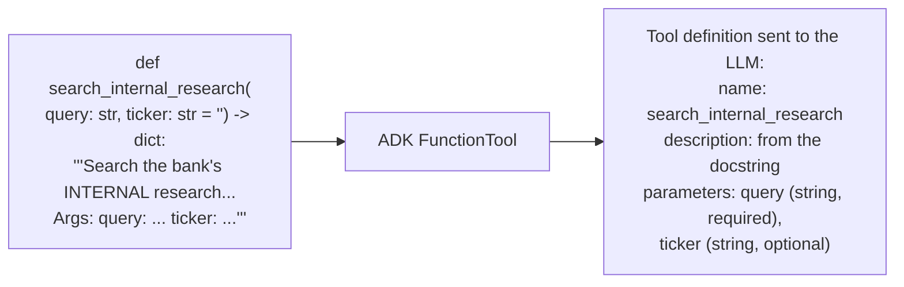

| Part of your function | Becomes |
|---|---|
| Function name | Tool name |
| Docstring | Tool description. **The LLM decides when to use the tool from this, so write it well.** |
| Parameters + type hints | Parameter schema (`str`, `int`, `float`, `bool`, `list`, `dict`) |
| Parameters with defaults | Optional parameters |
| Return value (a `dict` is best) | The result the LLM reads |

The real RAG tool from this project (`backend/app/tools/rag_tool.py`):

```python
def search_internal_research(query: str, ticker: str = "") -> dict:
    """Search the bank's INTERNAL research library (equity research notes, client coverage /
    relationship memos and sector outlooks) using semantic vector search (RAG).

    Args:
        query: what to look for, e.g. "relationship history and key contacts".
        ticker: optional company ticker (e.g. "NWLG") to restrict results to that client.

    Returns:
        dict with matching passages, each citing its source document and page.
    """
    ...
    return {"source": "Internal Research RAG (ChromaDB)", "query": query, "results": hits}
```

**Tips for good tools**
- **One clear job per tool.** `get_price_snapshot` and `get_fundamentals` beat one giant `get_everything`.
- **Write the docstring for the LLM:** when to use the tool, what each argument means, and an example value.
- **Return a `dict`**, including errors (`{"status": "error", "message": ...}`), rather than raising exceptions. The LLM can then react ("ticker not found, here are the covered clients").
- **Keep results small.** Everything you return is read by the LLM and costs tokens.

### 3.2 Tools that read or write session state: `ToolContext`

Add a parameter named `tool_context` with type `ToolContext`. ADK fills it in automatically and **hides it from the LLM**:

```python
from google.adk.tools import ToolContext

def set_meeting_context(ticker: str, company_name: str, meeting_purpose: str,
                        tool_context: ToolContext) -> dict:
    """Save the client being prepared for, so the specialist research agents know who to research."""
    tool_context.state["client_ticker"] = ticker.upper()      # write to the shared whiteboard
    tool_context.state["client_name"] = company_name
    tool_context.state["meeting_purpose"] = meeting_purpose
    return {"status": "ok"}
```

The LLM sees only `ticker`, `company_name` and `meeting_purpose`. This is how the coordinator in this project hands the client details to the other agents (Part 6).

### 3.3 MCP tools: tools from an external server

**MCP (Model Context Protocol)** is a standard way to expose tools from a separate program or service. ADK connects to an MCP server with `McpToolset`, asks it which tools it has, and turns each one into an ADK tool:

```python
import sys
from google.adk.tools.mcp_tool import McpToolset, StdioConnectionParams
from mcp import StdioServerParameters

factset_tools = McpToolset(
    connection_params=StdioConnectionParams(
        server_params=StdioServerParameters(
            command=sys.executable, args=["mcp_servers/factset_server.py"]),  # starts it as a subprocess
        timeout=30,
    ),
    tool_filter=["get_price_snapshot", "get_fundamentals"],   # optional: expose only some tools
)
```

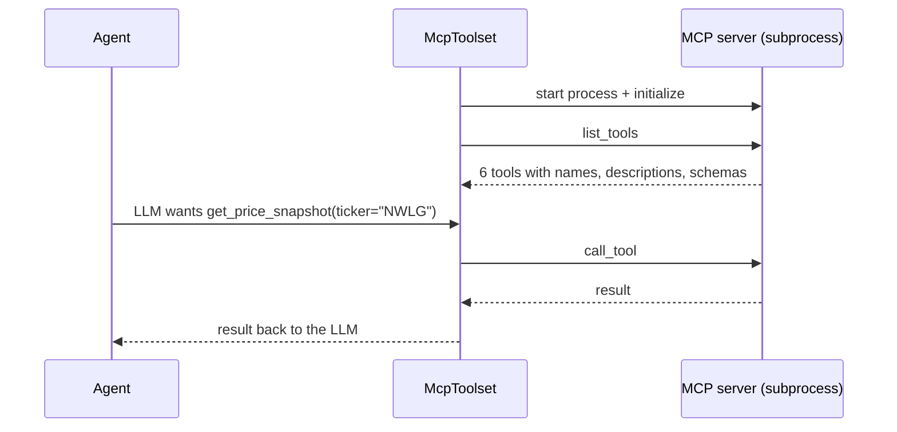

On the server side (this project's mock FactSet server, MCP Python SDK 2.x), a tool is a decorated function:

```python
from mcp.server.mcpserver import MCPServer
mcp = MCPServer(name="factset-mock")

@mcp.tool()
def get_price_snapshot(ticker: str) -> dict:
    """Latest price, daily/YTD performance, 52-week range, market cap..."""
    ...

mcp.run(transport="stdio")
```

For a remote MCP server, swap the connection for `StreamableHTTPConnectionParams(url="https://.../mcp")`. The agent code stays the same.

### 3.4 Which tools does each agent get?

**Give each agent only the tools it needs.** Fewer tools means fewer wrong choices.

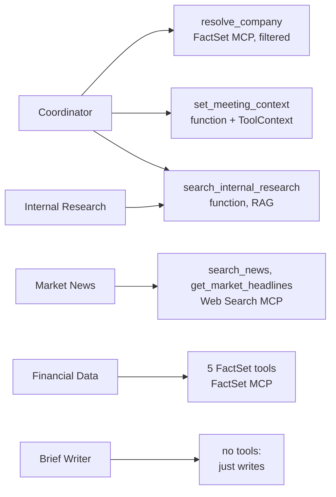

### 3.5 Tool types at a glance

| Tool type | How you create it | Use for |
|---|---|---|
| Function tool | Pass a Python function in `tools=[...]` | Your own logic, databases, RAG, APIs |
| Function tool with state | Add `tool_context: ToolContext` | Saving or reading shared data |
| MCP toolset | `McpToolset(connection_params=...)` | Tools served by an MCP server |
| Agent as a tool | `AgentTool(agent=other_agent)` | Calling another agent like a function (Part 7) |
| Built-in | e.g. `google_search` | Gemini-only extras |

---

## Part 4 — Multiple agents: the coordinator and sub-agents

### 4.1 Building a hierarchy

Any agent can have children through `sub_agents=[...]`. This builds a tree:

```python
news_agent = LlmAgent(name="news_agent", model=MODEL,
                      description="Finds the latest news about a company.",
                      instruction="...", tools=[news_tools])

data_agent = LlmAgent(name="data_agent", model=MODEL,
                      description="Provides stock prices and financial statements.",
                      instruction="...", tools=[factset_tools])

coordinator = LlmAgent(
    name="coordinator", model=MODEL,
    description="Front-door assistant for bankers.",
    instruction="""Help the banker. If they ask about news, transfer to news_agent.
If they ask about prices or financials, transfer to data_agent.""",
    sub_agents=[news_agent, data_agent],       # ← the hierarchy
)
```

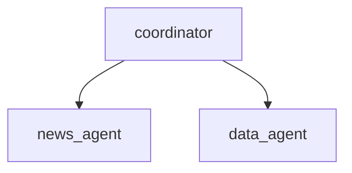

### 4.2 How the coordinator hands over: `transfer_to_agent`

When an `LlmAgent` has sub-agents, ADK **automatically gives it a `transfer_to_agent(agent_name)` tool** and tells the LLM which agents exist, using their **descriptions**. When the LLM calls it, the Runner switches control to that agent.

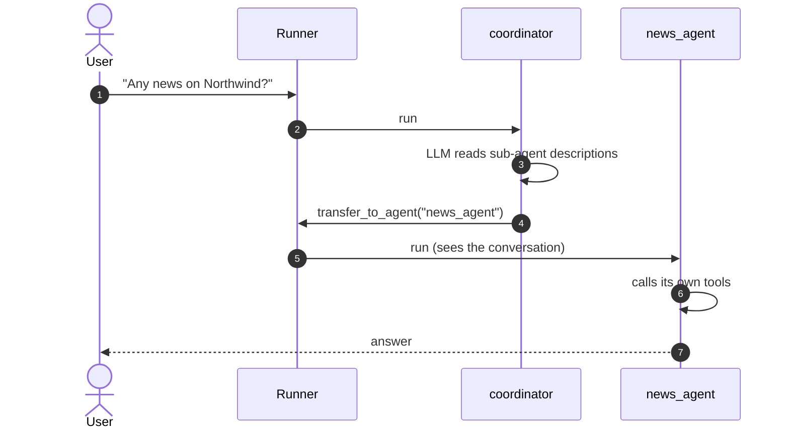

Things to know:
- **Descriptions matter.** The coordinator chooses based on each sub-agent's `description`, so make them specific.
- **Who answers the next message?** If the agent that answered last is an `LlmAgent` that's allowed to transfer, the next message goes **straight to it**. That's handy for follow-ups. Otherwise it goes back to the root agent.
- **Restricting transfers:** `disallow_transfer_to_parent=True` stops an agent handing work back up; `disallow_transfer_to_peers=True` stops it handing work sideways to siblings. Use them for specialists that should finish their own job.
- A transfer is a **hand-off, not a function call**. The coordinator doesn't get the result back to process further. If you need that, use `AgentTool` (Part 7).

---

## Part 5 — Workflow agents: Sequential, Parallel, Loop

Workflow agents contain **no LLM**. They are control flow written in code.

> ⚠️ **Version note (ADK 2.14):** `SequentialAgent`, `ParallelAgent` and `LoopAgent` still work but print a
> `DeprecationWarning`. ADK is moving to a new graph-based `Workflow` class (`google.adk.workflow`: nodes, edges,
> join nodes). ADK also says a `Workflow` **cannot yet be used as a sub-agent of an `LlmAgent`**, which is exactly how
> this project hangs its pipeline under the coordinator. So the classic workflow agents are still the right tool here.
> The concepts in this part (sequence, fan-out/fan-in, loops) carry over unchanged when you migrate later.

### 5.1 `SequentialAgent`: one after another

```python
pipeline = SequentialAgent(name="pipeline", sub_agents=[research_agent, writer_agent])
```

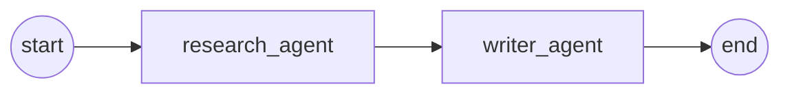

Use it when step 2 needs step 1's output.

### 5.2 `ParallelAgent`: all at once

```python
research_team = ParallelAgent(name="research_team",
                              sub_agents=[internal_research_agent, market_news_agent, financial_data_agent])
```

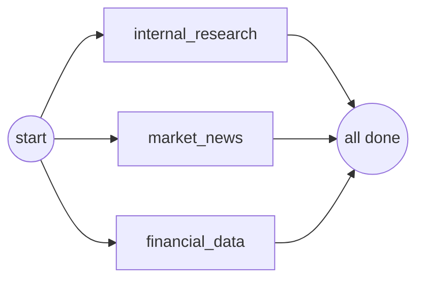

- The children run **concurrently**. Three agents that each take 20 seconds finish in about 20 seconds, not 60.
- Each child runs in its **own branch** and doesn't see the other children's messages. They **do share session state**, so give each one a **different `output_key`** so they don't overwrite each other.
- Use it when the tasks are **independent** of each other.

### 5.3 `LoopAgent`: repeat until done

```python
from google.adk.tools import exit_loop

critic = LlmAgent(name="critic", model=MODEL,
                  instruction="Review the draft in state. If it is good, call exit_loop. Otherwise list fixes.",
                  tools=[exit_loop])
refine = LoopAgent(name="refine", sub_agents=[writer_agent, critic], max_iterations=3)
```

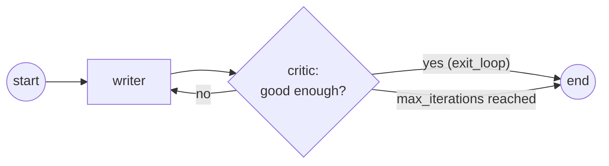

The loop stops when an agent **escalates** (the built-in `exit_loop` tool does this) or after `max_iterations`.

### 5.4 Nesting: workflows inside workflows

Workflow and LLM agents can be nested freely. This project's pipeline is a `ParallelAgent` inside a `SequentialAgent`:

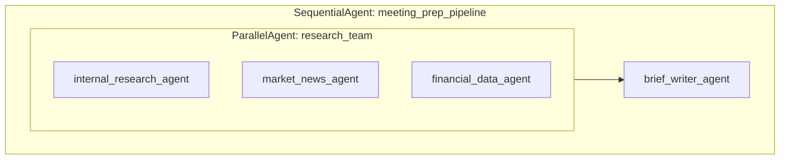

### 5.5 Which one should I use?

| Situation | Use |
|---|---|
| The LLM must understand a free-text request and decide what to do | `LlmAgent` with `sub_agents` |
| Steps must happen in a fixed order | `SequentialAgent` |
| Independent tasks that can run at the same time | `ParallelAgent` |
| Draft → review → improve until good | `LoopAgent` |

---

## Part 6 — Sharing data between agents

Agents mostly communicate through **session state**, the shared whiteboard. There are three ways to write to it and two ways to read from it.

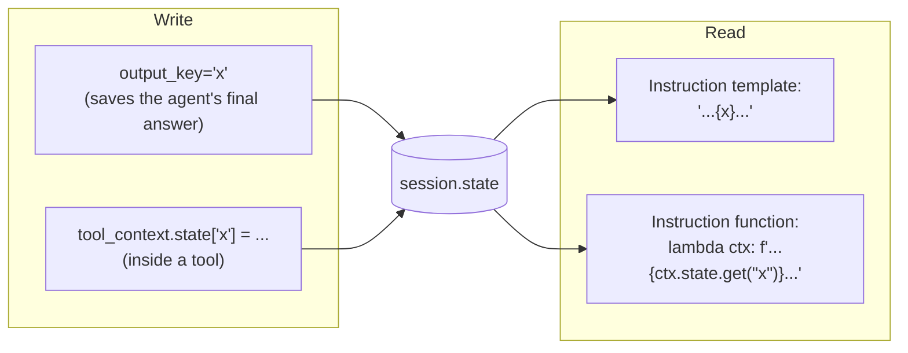

### 6.1 Writing: `output_key`

```python
market_news_agent = LlmAgent(..., output_key="market_news_findings")
```

When the agent finishes, its final text reply is saved to `state["market_news_findings"]` automatically.

### 6.2 Reading: instruction templates or instruction functions

**Option A, template string:** ADK replaces `{key}` with the value from state.

```python
writer = LlmAgent(..., instruction="Write a brief using these findings:\n{market_news_findings}")
```

> ⚠️ If the key isn't in state yet, the template raises an error.

**Option B, instruction function (used in this project):** pass a function that receives a context and returns the prompt. You handle missing values yourself:

```python
brief_writer_agent = LlmAgent(
    ...,
    instruction=lambda ctx: f"""Write the meeting brief.
=== MARKET NEWS ===
{ctx.state.get('market_news_findings') or '(no data)'}
=== FINANCIAL DATA ===
{ctx.state.get('financial_findings') or '(no data)'}""",
)
```

### 6.3 `include_contents="none"`: focused agents

By default an `LlmAgent` sees the whole conversation history. With `include_contents="none"` it sees **only its instruction**. That's ideal for specialists that get everything they need from state, because their prompts stay short and they aren't distracted by other agents' messages.

### 6.4 The data flow in this project

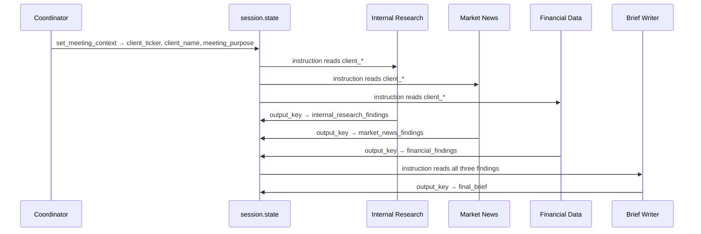

---

## Part 7 — Three ways for a coordinator to use other agents

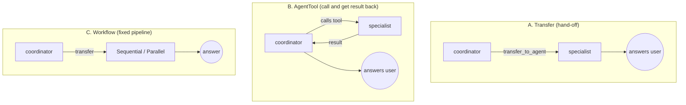

| Pattern | How | Coordinator gets the result back? | Good for |
|---|---|---|---|
| **A. Transfer** | `sub_agents=[specialist]`; the LLM calls `transfer_to_agent` | No: the specialist takes over the conversation | Routing ("send this to the right expert") |
| **B. AgentTool** | `tools=[AgentTool(agent=specialist)]` | **Yes**: the specialist's final answer comes back as a tool result | The coordinator combining several answers itself |
| **C. Workflow** | Transfer to a `SequentialAgent` / `ParallelAgent` | The pipeline produces the final answer | Repeatable, multi-step jobs |

AgentTool example:

```python
from google.adk.tools.agent_tool import AgentTool

coordinator = LlmAgent(
    name="coordinator", model=MODEL,
    instruction="Use news_agent and data_agent as tools, then summarise both for the banker.",
    tools=[AgentTool(agent=news_agent), AgentTool(agent=data_agent)],
)
```

**This project uses A + C:** an LLM coordinator understands the request, then transfers to a fixed pipeline that always runs all three researchers in parallel and then the writer. Why not B? With `AgentTool`, the inner agents' steps don't appear in the main event stream, and the UI shows each agent working live.

---

## Part 8 — Walkthrough: the Client Brief agent graph

Open `backend/app/agents/agent.py` alongside this section.

### 8.1 The whole tree

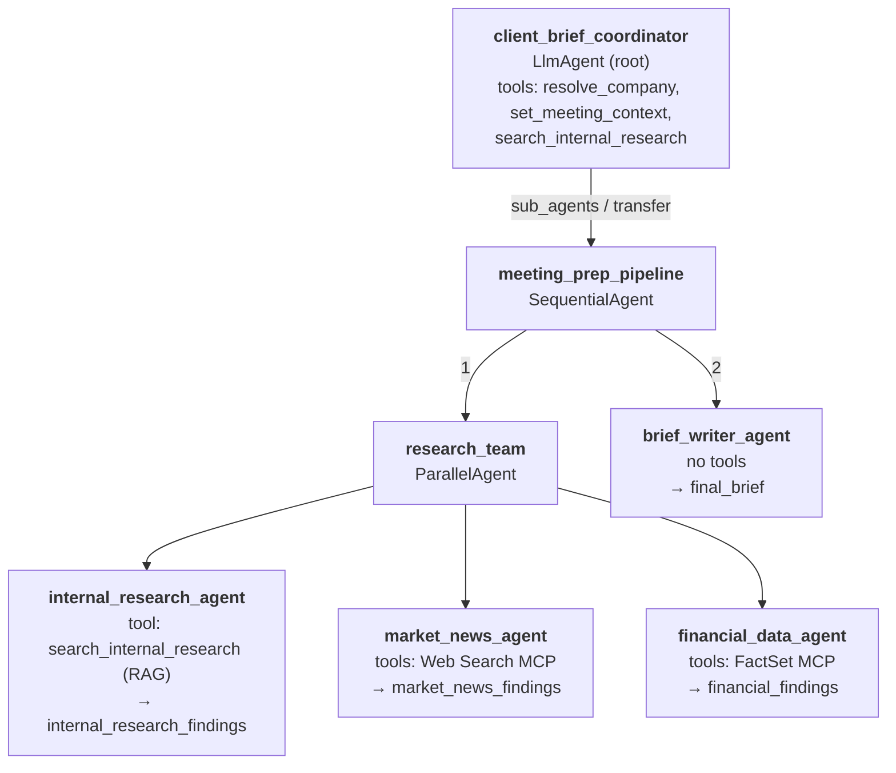

### 8.2 Build it bottom-up

**Step 1, the model.** All agents share Claude objects:

```python
LEAD_LLM = AnthropicLlm(model=CLAUDE_MODEL, max_tokens=CLAUDE_MAX_TOKENS)
SPECIALIST_LLM = AnthropicLlm(model=CLAUDE_SPECIALIST_MODEL, max_tokens=CLAUDE_MAX_TOKENS)
GEN_CONFIG = AnthropicGenerateContentConfig(effort=CLAUDE_EFFORT)   # how much Claude reasons
```

**Step 2, a specialist.** It reads the client from state, has one tool, and saves its result:

```python
internal_research_agent = LlmAgent(
    name="internal_research_agent",
    model=SPECIALIST_LLM,
    description="Searches the bank's internal research library (RAG over PDFs).",
    instruction=lambda ctx: f"""You are the Internal Research specialist at an investment bank.
{_client(ctx)}
Use the `search_internal_research` tool (pass the ticker) at least 3 times ...
After every bullet, cite the source in the form [RAG: <document file name> p.<page>].""",
    tools=[search_internal_research],
    include_contents="none",                 # sees only its instruction
    output_key="internal_research_findings", # result → state
    generate_content_config=GEN_CONFIG,
    disallow_transfer_to_parent=True,        # finish your own job
    disallow_transfer_to_peers=True,
)
```

`market_news_agent` and `financial_data_agent` follow the same pattern with MCP toolsets instead of the RAG function.

**Step 3, run the three specialists in parallel:**

```python
research_team = ParallelAgent(
    name="research_team",
    sub_agents=[internal_research_agent, market_news_agent, financial_data_agent],
)
```

**Step 4, the writer.** No tools; it reads all three findings from state:

```python
brief_writer_agent = LlmAgent(
    name="brief_writer_agent", model=LEAD_LLM,
    instruction=lambda ctx: f"""... write ONE Markdown brief ...
=== INTERNAL RESEARCH (RAG) ===
{ctx.state.get('internal_research_findings') or '(no data)'}
=== MARKET NEWS (Web Search MCP) ===
{ctx.state.get('market_news_findings') or '(no data)'}
=== FINANCIAL DATA (FactSet MCP) ===
{ctx.state.get('financial_findings') or '(no data)'}""",
    include_contents="none", output_key="final_brief", ...
)
```

**Step 5, research first, then write:**

```python
meeting_prep_pipeline = SequentialAgent(
    name="meeting_prep_pipeline",
    description="Prepares a full client meeting brief: parallel research ..., then synthesis.",
    sub_agents=[research_team, brief_writer_agent],
)
```

**Step 6, the coordinator** talks to the banker and decides when to start the pipeline:

```python
root_agent = LlmAgent(
    name="client_brief_coordinator", model=LEAD_LLM,
    instruction=lambda ctx: f"""...
1. Call `resolve_company` with the name or ticker they gave.
2. Call `set_meeting_context` with the resolved ticker, company name and meeting purpose.
3. Transfer to the `meeting_prep_pipeline` agent ... Do not write the brief yourself. ...""",
    tools=[
        _mcp_toolset("factset_server.py", tool_filter=["resolve_company"]),
        set_meeting_context,
        search_internal_research,
    ],
    sub_agents=[meeting_prep_pipeline],      # gives it transfer_to_agent
)
```

### 8.3 One request, end to end

*"Prepare me for my meeting with Northwind Logistics about refinancing."*

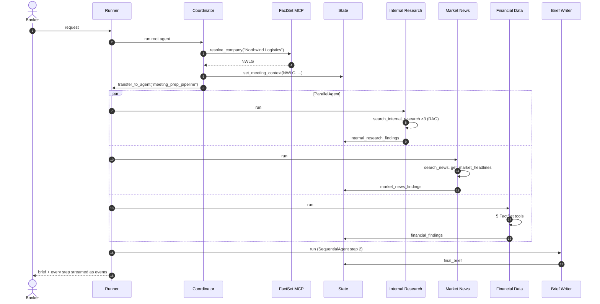

The follow-up *"What should I avoid with the CEO?"* goes back to the coordinator. It answers from the conversation, which now contains the brief.

### 8.4 Which ADK concept is used where

| Concept | Where in this project |
|---|---|
| `LlmAgent` | coordinator, 3 specialists, writer |
| Function tool | `search_internal_research`, `set_meeting_context` |
| `ToolContext` + state | `set_meeting_context` |
| `McpToolset` (stdio) + `tool_filter` | FactSet and Web Search servers |
| `sub_agents` + `transfer_to_agent` | coordinator → pipeline |
| `SequentialAgent` | `meeting_prep_pipeline` |
| `ParallelAgent` | `research_team` |
| `output_key` | each specialist and the writer |
| Instruction functions | every agent (`lambda ctx: ...`) |
| `include_contents="none"` | specialists and writer |
| `disallow_transfer_*` | specialists and writer |
| `Runner` + events | `backend/app/chat_service.py` |

---

## Part 9 — Running agents and watching what they do

### 9.1 Events are the window into your agents

Every step is an `Event`. In this project `chat_service.py` turns them into messages the UI understands:

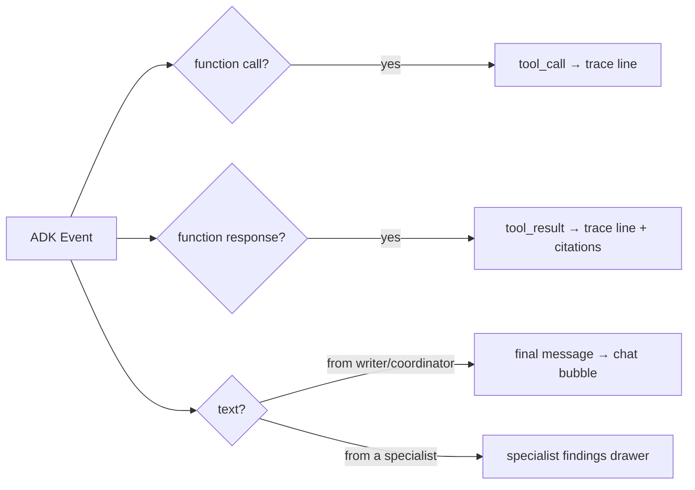

Useful `Event` fields:

| Field / method | Meaning |
|---|---|
| `event.author` | Which agent produced it |
| `event.get_function_calls()` | Tool calls the LLM requested |
| `event.get_function_responses()` | Tool results |
| `event.content.parts[i].text` | Text the agent wrote |
| `event.is_final_response()` | This is an agent's final answer |
| `event.actions.state_delta` | State changes made in this step |
| `event.actions.transfer_to_agent` | A transfer happened |

### 9.2 ADK's built-in developer UI

ADK ships a web UI that lets you chat with an agent and inspect every event, tool call and state change. Put an agent in a folder like this:

```
my_agents/
└── price_agent/
    ├── __init__.py      # contains: from . import agent
    └── agent.py         # defines root_agent = LlmAgent(...)
```

Then run this from inside `my_agents/` and open the URL it prints:

```bash
adk web
```

`adk run price_agent` gives a chat in the terminal instead.

### 9.3 Testing without spending LLM credits

You can replace the model with a scripted fake to check the wiring: transfers, parallel execution, state, tool calls. This project was tested that way by patching the Anthropic SDK's `messages.create` to return pre-written tool calls. It confirms orchestration, not answer quality.

---

## Part 10 — Common mistakes

| Symptom | Likely cause | Fix |
|---|---|---|
| The LLM never calls your tool | Vague docstring, or the instruction doesn't mention the tool | Describe when to use it; name the tool in the instruction |
| The coordinator transfers to the wrong agent | Similar or vague sub-agent `description`s | Make each description specific and distinct |
| The coordinator writes the answer itself instead of delegating | The instruction doesn't say to delegate | "Transfer to X. Do not answer yourself." |
| Parallel agents overwrite each other's results | Same `output_key` | Give each a unique `output_key` |
| `KeyError` or template error in an instruction | A `{key}` template ran before the key was set | Use an instruction function with `ctx.state.get(key)` |
| A specialist goes off and hands work to another agent | Transfers allowed | `disallow_transfer_to_parent=True`, `disallow_transfer_to_peers=True` |
| Follow-ups go to a specialist instead of the coordinator | The last agent was an `LlmAgent` that can transfer | Restrict its transfers, or put specialists inside a workflow agent (as here) |
| Specialists are confused by unrelated chat history | They see the whole conversation | `include_contents="none"` and pass data via state |
| An agent invents numbers | It isn't told to stick to tool results | "Only use facts returned by the tools" + source citations |
| `400` errors about `temperature` with new Claude models | Sampling parameters are rejected | Set `effort` in `AnthropicGenerateContentConfig` instead |
| MCP tools missing | Server failed to start, or a `tool_filter` typo | Run the server script directly to see its errors; check the names |
| A bare `"claude-..."` model string tries to use Google Cloud | ADK maps those strings to its Vertex AI `Claude` class | Use `AnthropicLlm(model="claude-...")` for the Anthropic API |

---

## Part 11 — Exercises

**Exercise 1, add a tool.** Add `get_dividend_history(ticker)` to the mock FactSet server (`backend/mcp_servers/factset_server.py`) and add it to the Financial Data agent's instruction. *Check:* the activity trace shows the new tool being called.

**Exercise 2, add a fourth specialist.** Create an `esg_agent` that searches internal research for ESG and sustainability topics:
1. Define it like `internal_research_agent`, with a new `output_key="esg_findings"`.
2. Add it to `research_team.sub_agents`. It now runs in parallel with the others.
3. Add an `=== ESG ===` block to the brief writer's instruction that reads `esg_findings`.
4. Add it to `AGENT_LABELS` in `chat_service.py` and to `AGENTS` in `frontend/src/components/AgentPanel.jsx` so it appears in the UI.

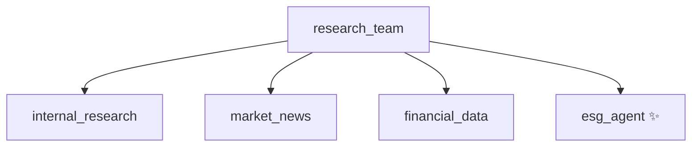

**Exercise 3, add a review loop.** Wrap the brief writer in a `LoopAgent` with a `critic` agent that checks every section has a source citation and calls `exit_loop` when satisfied. Use `max_iterations=2`.

**Exercise 4, try `AgentTool`.** Give the coordinator `AgentTool(agent=market_news_agent)` so it can answer "any news on Aurora?" directly, without running the full pipeline. Notice what changes in the UI trace.

---

## Glossary

| Term | Meaning |
|---|---|
| **Agent** | An LLM with instructions and tools that loops until it can answer |
| **LlmAgent / Agent** | ADK's LLM-powered agent class |
| **Workflow agent** | Sequential, Parallel or Loop agent: fixed control flow, no LLM |
| **Sub-agent** | A child agent listed in `sub_agents` |
| **Coordinator / root agent** | The top agent the Runner starts with |
| **Transfer** | An LLM agent handing control to another agent via `transfer_to_agent` |
| **Tool** | A function or service an agent can call |
| **FunctionTool** | A Python function wrapped as a tool (automatic) |
| **ToolContext** | Hidden tool parameter that gives access to state |
| **MCP** | Model Context Protocol, a standard for exposing tools from servers |
| **McpToolset** | ADK class that connects an agent to an MCP server |
| **AgentTool** | Wraps an agent so another agent can call it like a function |
| **Session** | One conversation's history and state |
| **State** | Key-value data shared by all agents in a session |
| **output_key** | Saves an agent's final answer into state |
| **Instruction provider** | A function that builds an agent's prompt at runtime |
| **Runner** | Executes agents and yields events |
| **Event** | A record of one step (message, tool call, tool result, transfer) |
| **RAG** | Retrieval-augmented generation: searching documents to ground answers |

---

**Next steps:** read [DESIGN.md](DESIGN.md) for the full architecture of this app, including how the RAG index is built, and the official ADK documentation at https://google.github.io/adk-docs/.
